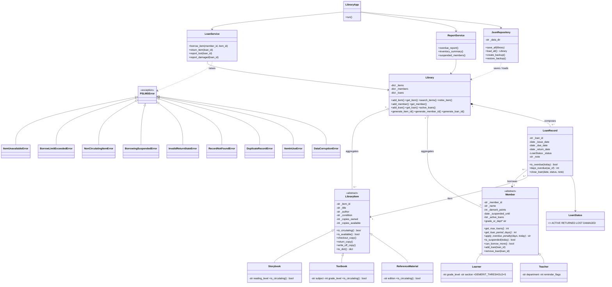

# UML Class Diagram

Render with any Mermaid viewer (GitHub, VS Code "Markdown Preview Mermaid", https://mermaid.live)
or redraw in draw.io/Lucidchart for the formal deliverable.

## Relationship justification
| Relationship | Type | Why |
|---|---|---|
| Library → LoanRecord | **Composition** | A loan only has meaning inside the library that issued it; the Library creates and owns every loan. |
| Library → LibraryItem / Member | **Aggregation** | Items and members are independent concepts the library keeps track of. |
| LoanRecord → Member / LibraryItem | **Association** (1 each) | A loan *refers to* a borrower and an item but does not own them; both outlive the loan. |
| Learner/Teacher → Member | **Inheritance** | A learner *is a* member; shared identity/suspension state lives in the base class. |
| Storybook/Textbook/Reference → LibraryItem | **Inheritance** | Each *is a* catalog item sharing ID, title, author and stock handling. |

> **Note vs. the proposal:** the proposal described LoanRecord as "composing" Member and LibraryItem.
> Because a Member does not die when a loan is closed, that relationship is really an *association*,
> and the true composition is **Library → LoanRecord**. Be ready to explain this in the defense.
> `Member.grade_or_dept` is now a derived property (Learner: "Grade 5 - Narra"; Teacher: department)
> instead of a stored field, to avoid duplicating `grade_level`/`section`/`department`.
